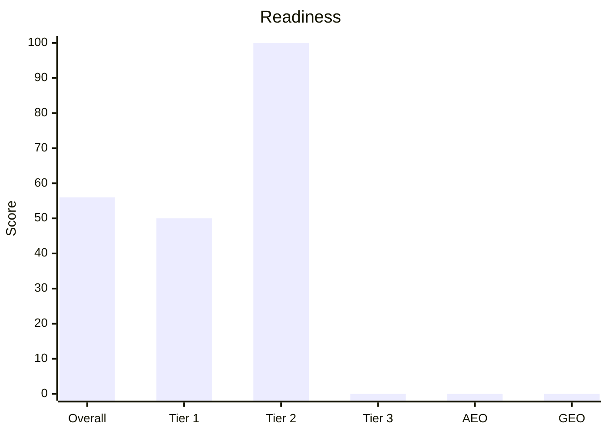

# Prerequisites
- Required: a public URL, local preview URL, or landing files. If the user gave none, ask for the target and stop.
- Helpful but optional: customer name, offer, audience, target market and locale, conversion goal, competitors, CMS, recent migration history, and linked Knowledge Base.
- Optional evidence: Google Search Console, GA4 or other analytics, Google Business Profile, Bing Webmaster Tools, rank tracking, backlink exports, and field Core Web Vitals.
- Access to rendered HTML when a check needs it. Audit what is public when private data is absent, and mark data-dependent checks Unknown.

# Steps
1. Record the customer and scope. State the target URL, whether this is one-page or site-wide, the primary conversion, market, locale, and any missing context. If several URLs are possible, identify the primary landing and the representative URLs you will sample.
2. Establish the evidence set. Inspect the rendered page, status and response headers, source HTML, `robots.txt`, XML sitemap, canonicals, metadata, structured data, internal links, mobile layout, and performance data you can actually measure.
3. Search the linked Knowledge Base and supplied exports for approved claims, target queries, terminology, competitors, and baselines. If they are absent, infer provisional query themes, label them Unconfirmed, and continue.
4. Run Tier 1, Tier 2, Tier 3, AEO, and GEO below. Use Pass, Fail, Unknown, or Not applicable. Every result needs evidence. Every Fail needs impact, what to change, and how to change it.
5. For a site-wide request, inspect templates plus a representative sample: home, the target landing, one conversion page, one content page, and localized or parameterized variants when present. List the exact URLs sampled.
6. Prioritize findings by customer impact, confidence, and effort. Put blockers before optimizations and separate quick wins from structural work.
7. Save the completed checks as JSON. Do not put a score in that file. The report script calculates it. On every Fail, fill `what` and `how`.
8. From this skill folder, run `python3 scripts/write_report_pdf.py <audit.json> --out <customer>-seo-geo-aeo-report.pdf`. Install `fpdf2` if the script asks for it. Pass `--font` only when it cannot find a Korean-capable font.
9. Use the script's printed score, grade, coverage, and fix count in the reply. Show each score as a bar chart with the number on it. Do not invent or round a different score.
10. Stop after the PDF unless the user explicitly asked for implementation.

## SEO Tier 1 — Technical eligibility and measurement
A Fail here can prevent discovery, indexing, rendering, measurement, or conversion.

- HTTPS and a `200` (or an intentional, single-hop redirect) on the canonical URL
- The page is crawlable and indexable: no accidental `noindex`, auth wall, CDN block, robots restriction, or snippet control that conflicts with the goal
- Canonical points at the preferred URL (self-canonical when this is the original)
- XML sitemap contains canonical indexable URLs with accurate `lastmod`; `robots.txt` references it when appropriate
- Redirects, trailing slashes, protocols, host variants, parameters, and duplicate URLs resolve consistently
- Rendered HTML exposes the primary content and links to crawlers
- One unique `title` aligned with the primary query theme
- One unique meta `description` that states the offer without duplicating another route
- Exactly one `h1`, aligned with the title and the search intent
- Clean, stable URL with no session IDs or uncontrolled duplicate parameter copies
- Mobile viewport, usable mobile layout, and no blocking interstitial
- Language set (`html lang`, and `hreflang` when the site has locales)
- Core Web Vitals from field data when available; otherwise clearly labeled lab measurements
- Analytics and primary conversion tracking are present and testable, or Unknown without access
- Search Console and Bing Webmaster Tools ownership and indexing coverage when the customer provides access

## SEO Tier 2 — Relevance, experience, and conversion
This layer determines whether the landing deserves the query and satisfies the visitor.

- Search intent matches a landing page (commercial / transactional), not a blog or a docs article
- Heading hierarchy is `h1` → `h2` → `h3` with no skipped levels
- The primary query theme appears naturally in the title, H1, and opening copy without stuffing
- Supporting commercial and problem-aware themes appear only where they serve a distinct section
- Copy states who the offer is for, the problem, the differentiated outcome, proof, objections, and what happens after the CTA
- Primary CTA is visible and its destination or action works; secondary actions do not compete with it
- Images have descriptive `alt`, or empty `alt` when decorative; file names are readable
- Internal links point into the landing from relevant pages and out to pricing, proof, documentation, or policies when those pages exist
- Open Graph and Twitter metadata with a real image, title, and description
- No thin or placeholder copy on a production route
- No search-intent cannibalization against another indexable route in the sampled site
- Trust and accessibility basics support conversion: contact path, privacy/terms where required, keyboard flow, labels, contrast, and error feedback
- Local intent checks Business Profile, NAP, service area, and local proof only when the customer serves a location
- International intent checks localized canonicals and `hreflang` only when the customer targets multiple locales

## SEO Tier 3 — Authority, entities, and competitive depth
This layer tests whether the customer provides enough evidence and coverage to compete.

- Long-tail and question coverage addresses real evaluation questions without padding the page
- Entity clarity: product, company, and category names are consistent with the Knowledge Base
- Experience and trust signals identify who operates the site, how to contact them, and who produced expert claims where relevant
- Claims have visible support: examples, methodology, case studies, reviews, policies, citations, or approved customer evidence
- Structured data uses only applicable types, validates, and matches visible content. It is an eligibility aid, not a ranking or citation promise
- Supporting pages form a useful cluster around use cases, comparisons, documentation, pricing, and proof when the business needs them
- Competitor and live-SERP gaps are based on observed pages or supplied research, not remembered search results
- Backlink, mention, and reputation findings use supplied or measured data; without it they are Unknown
- Organization identity, `sameAs`, authorship, contact details, and Business Profile information agree across sources where applicable
- Freshness is truthful: stale offers and facts are fixed; dates are not changed merely to look recent

## AEO — Answer engines
Answer-engine eligibility starts with ordinary SEO. There is no required “AI schema” or AI text file. AEO is whether a search answer surface can select this page. It is not the GEO check.

- The page is indexable and eligible to show a search snippet; crawl and snippet controls match the customer’s desired participation
- Important content is available as visible text, not only inside images, video, canvas, or interaction-only UI
- A concise passage explains what the offer is, who it is for, and the outcome in factual language
- Question-led sections answer genuine customer questions directly before expanding with proof or detail
- Answers are complete on the page rather than “contact us” teasers, and each section stays focused on one topic
- Quotable facts — category, compatibility, location, pricing model, process, and comparisons — are approved, current, and supported
- Hero, body, FAQ, metadata, structured data, Merchant Center, and Business Profile do not contradict one another when applicable
- Structured data matches visible content and eligible rich-result types; special AEO markup is not required
- Snippet directives (`nosnippet`, `data-nosnippet`, `max-snippet`, Bing cache controls) do not unintentionally suppress useful citations
- Fresh changes are discoverable through accurate sitemaps and, where supported, IndexNow
- Google Search Console and Bing Webmaster Tools AI/citation reports are reviewed when the customer provides access; citation counts are not treated as rankings
- `llms.txt` is optional. Its absence is not a Fail, and its presence is checked only for accuracy and contradictions

## GEO — Generative engines
GEO checks whether ChatGPT, Perplexity, Gemini, or Claude can discover this brand and repeat the offer without inventing a competitor’s facts. Do not score a live mention you did not query. Do not require `llms.txt`. For each check below, a Fail must copy the What and How into the audit JSON, filled with this page’s evidence.

- **Citation crawlers match the customer’s choice.** Read `robots.txt` for `OAI-SearchBot`, `ChatGPT-User`, `PerplexityBot`, `ClaudeBot`, and `Bingbot`. Fail only when a bot is blocked and the customer wants that engine to cite them. A block of training bots such as `GPTBot` or `Google-Extended` is Not applicable when search and citation bots stay allowed. Unknown when `robots.txt` cannot be fetched.
  - What: allow the citation bot the customer cares about, or record that the block is intentional.
  - How: name the User-agent group and the line to change. Do not flip every AI user-agent to Allow.
- **A model can quote what this is.** The first screen has plain HTML text, not only an image or meta description, that states the product name, who it is for, and the outcome in one to three sentences.
  - What: add or rewrite that passage under the H1.
  - How: use the approved product name from the Knowledge Base when one exists. Put the sentences in the DOM as text. Leave the same words out of `alt` only.
- **One entity name.** The product, company, and category strings match across `title`, H1, the visible about line, and Organization or Product JSON-LD. `sameAs` URLs resolve and are the customer’s profiles.
  - What: pick the canonical string and list every mismatched place.
  - How: replace each mismatched string with the canonical one, and delete `sameAs` URLs that 404 or point at a different brand.
- **Facts a model would repeat are sourced.** Statistics, plan limits, pricing model, compatibility, and superlatives that a model would quote have a visible source, method, or date on the same page. A slogan with no number is not this check.
  - What: attach the source next to the sentence, or remove the superlative.
  - How: add the origin in the same section, for example the measurement date or the policy URL. Do not invent a statistic to fill the gap.
- **Original information gain.** The page states at least one fact a generic category article does not: a named integration, a constraint, a process step, or a measured result from this customer.
  - What: add one original fact in text.
  - How: take it from the Knowledge Base or from copy already approved on the site. If none exists, mark Unknown and say which fact the customer must supply. Do not write a placeholder result.
- **Buyer questions are self-contained.** Each important evaluation question is answered in complete sentences inside that section, so a model can lift one passage without the rest of the page.
  - What: name the section whose answer depends on another block or an image.
  - How: open the section with the answer sentence, then the proof. Repeat the product name in that sentence.
- **Comparisons state criteria.** When the page positions against a category or a named alternative, the criteria and the conclusion are in text. If the query theme is comparative and the page has no criteria, Fail. If the offer is not comparative, Not applicable.
  - What: add the missing criterion or the missing conclusion.
  - How: use a short list or table with the criterion, this product, and the alternative. Do not leave the comparison as a slogan in a graphic.
- **Pages a model would blend do not disagree.** Home, pricing, docs, and FAQ agree on plan names, limits, and who the product is for. Check the sampled URLs. This is the cross-page blend risk, not the on-page snippet check in AEO.
  - What: name the two URLs and the conflicting fact.
  - How: keep the newer approved fact, update the other URL, and say which sentence to delete.
- **Operator and freshness are visible.** The page shows who operates the site and a truthful date beside facts that change, such as price or limits. A date in the footer that was bumped without an edit is a Fail.
  - What: add the operator, or correct the date that does not match the content.
  - How: put the legal or brand name where a reader can see it, and set the date from the last real change to that fact.
- **`llms.txt` agrees with the page when it exists.** Absence is Not applicable. A file that names a different product, price, or audience is a Fail.
  - What: correct the contradicting line, or remove the file.
  - How: quote the file line and the page sentence that should replace it.
- **Live generative mention.** When you can query an engine in this audit, record the engine, the prompt, the date, and whether the brand was named correctly, misstated, or absent. Without that query, Unknown. Never fill this from memory.
  - What: only after a real query, name the false sentence the engine produced or the query that omitted the brand.
  - How: point at the on-site passage that should have been quoted, and the contradiction to remove. If the check is Unknown, the how is the query to run next, not a fake citation.

# Report
Use this shape. Keep site-wide and page-specific findings distinguishable. Every Fail row has both What and How.

```markdown
# Landing SEO / GEO / AEO audit
Customer:
Primary URL:
Scope and sampled URLs:
Market / locale / conversion:
Evidence available:
Evidence missing:
Query source: customer data | Knowledge Base | inferred (unconfirmed)

## Executive verdict
- Overall readiness:
- Largest business risk:
- Highest-leverage opportunity:

## Scorecard
| Layer | Pass | Fail | Unknown | Not applicable |
|---|---:|---:|---:|---:|
| SEO Tier 1 | | | | |
| SEO Tier 2 | | | | |
| SEO Tier 3 | | | | |
| AEO | | | | |
| GEO | | | | |

## SEO Tier 1
| Check | Scope | Result | Evidence | What to improve | How | Owner | Verify |
|---|---|---|---|---|---|---|---|
| | | | | | | | |

## SEO Tier 2
| Check | Scope | Result | Evidence | What to improve | How | Owner | Verify |
|---|---|---|---|---|---|---|---|
| | | | | | | | |

## SEO Tier 3
| Check | Scope | Result | Evidence | What to improve | How | Owner | Verify |
|---|---|---|---|---|---|---|---|
| | | | | | | | |

## AEO
| Check | Scope | Result | Evidence | What to improve | How | Owner | Verify |
|---|---|---|---|---|---|---|---|
| | | | | | | | |

## GEO
| Check | Scope | Result | Evidence | What to improve | How | Owner | Verify |
|---|---|---|---|---|---|---|---|
| | | | | | | | |

## What to improve and how
| Priority | Layer | What | How | Impact | Effort | Verify |
|---|---|---|---|---|---|---|
| | | | | | | |

## 30 / 60 / 90 days
- 0–30 days:
- 31–60 days:
- 61–90 days:

## Measurement plan
- Baseline:
- KPI:
- Recheck date:
```

## Audit JSON
Write one object. `language` is `ko` or `en`. `layer` is `tier1`, `tier2`, `tier3`, `aeo`, or `geo`. `result` is `pass`, `fail`, `unknown`, or `na`. Every Fail includes `what` and `how`. `what` is the specific element to change. `how` is the steps, including the URL or selector and how to verify. Do not write "improve GEO" in either field.

```json
{
  "language": "ko",
  "customer": "Northwind",
  "url": "https://example.com",
  "auditedAt": "2026-10-08",
  "scope": "Homepage and pricing page",
  "verdict": "Indexable, but a generative engine cannot quote the offer.",
  "plan": { "d30": ["Add a plain-text definition under the H1"], "d60": [], "d90": [] },
  "checks": [
    {
      "layer": "geo",
      "check": "A model can quote what this is",
      "result": "fail",
      "impact": "high",
      "evidence": "https://example.com first screen text is only the image alt 'Hero'.",
      "what": "Add a visible two-sentence definition that names Northwind, the buyer, and the outcome.",
      "how": "Put the sentences in HTML directly under the H1 on https://example.com. Verify by viewing source, not by reading the image."
    }
  ]
}
```

# Gotchas
- A missing Knowledge Base or private analytics access does not block the public audit. Label the limitation and continue.
- Preview or auth-walled URLs are often `noindex`. Do not Fail a production URL for a preview header you saw on staging unless they are the same URL.
- Client-rendered titles can differ from the static file. Prefer the rendered document when you can fetch it.
- AEO is not “add FAQ schema.” Google does not require special AI markup, and schema never guarantees a citation.
- GEO is not “add `llms.txt`” and not a second copy of the AEO list. Score the generative-engine checks even when AEO passes.
- Do not Fail a deliberate training-crawler opt-out. Fail a citation-crawler block only when the customer wants that engine to cite them.
- Do not apply `FAQPage` merely because the page has questions. Use only markup that is applicable, supported, visible, and valid.
- Do not compare customers against remembered rankings or remembered chatbot answers. Use live evidence or mark the comparison Unknown.
- The readiness score belongs to `scripts/write_report_pdf.py`. A hand-written score is not the report.
- A score without its graph is not a report. Use the PDF graphs, and repeat the same values in the reply as a bar chart.
- A Fail without both `what` and `how` is incomplete. Name the element, the change, and the check that proves it.

# Output
**Deliverable** — The script's PDF, with score graphs beside the numbers, a GEO section, and a numbered list of what to improve and how.
**Done when** — The PDF exists, its score matches the script output, the reply shows those same scores as a bar chart, every applicable check has evidence, every Fail has what and how, and no ranking or citation is promised.

In the reply, use the script's numbers in this chart. Replace only the values. A missing layer score is `0` and the caption says it was not scored.


